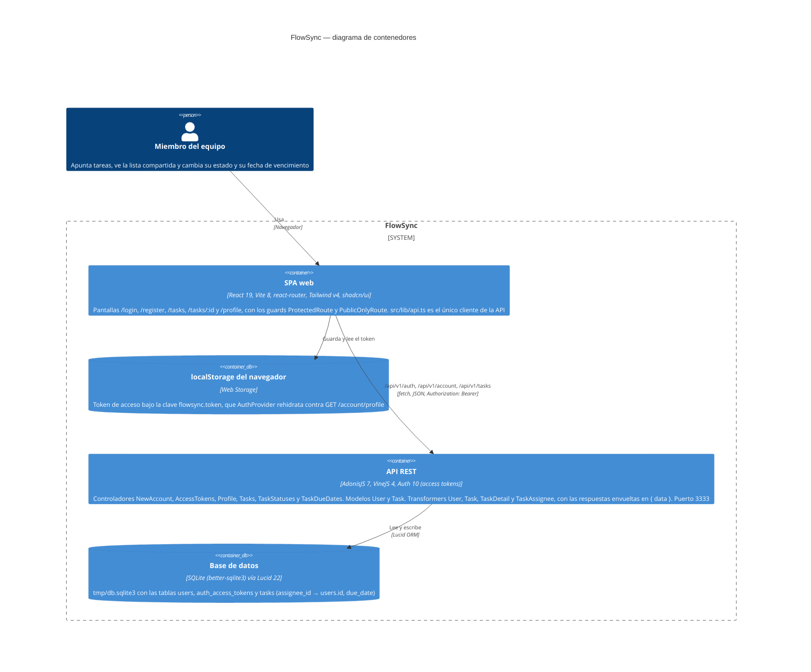

# Arquitectura de FlowSync

Diagrama de contenedores (estilo C4) de FlowSync tal como está hoy en el código. La persona usa una SPA de React (`frontend/`) que guarda el token de acceso en el `localStorage` del navegador y habla con la API de AdonisJS (`backend/`) por HTTP con JSON, pasando siempre por `src/lib/api.ts`. La API agrupa sus rutas bajo `/api/v1` (las de cuenta y tareas, protegidas con el middleware `auth` del guard de access tokens), responde a través de transformers envueltos en `{ data }` y persiste con Lucid en un único fichero SQLite. Dentro de cada contenedor solo se nombran las piezas que existen en el repo: las pantallas y rutas de React, y los controladores, modelos y transformers del backend.

